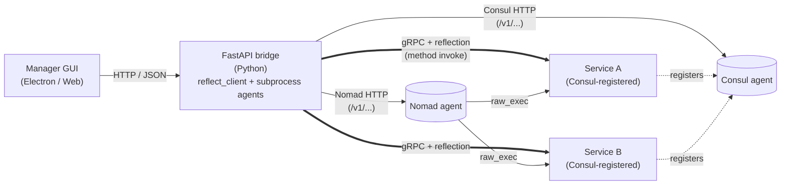

# Microservice Manager GUI

A Bootstrap-based desktop / web app that wraps the FastAPI bridge with
a friendly UX for **operating** the runtime (start/stop Consul + Nomad,
inspect services, submit jobs) and **building** new ones (the Service
Creator wizard, equivalent to `mb-scaffold`).

> The services, their runtime and the framework architecture live in the
> MicroserviceBase repo (`test-fullautomation/python-microservice-base`);
> this repo holds the GUI and its bridge (`bridge/`).

## What you can do here

| Task | Where |
|---|---|
| Start / stop Consul + Nomad agents, inspect cluster state, submit jobs | **Service Network** mode → see [Operating Consul + Nomad](docs/md/ops_consul_nomad.md) |
| Generate a new service scaffold (proto + domain + adapter + clients + Nomad HCL) | **Service Creator** mode → see [Service Creator wizard guide](docs/md/service_creator.md) |
| Inspect a running service, browse its gRPC methods, send test calls | **Services** mode (covered in the Operating doc above) |
| Use the in-app help (lighter, embedded inside the GUI itself) | Click the **?** in the navbar — renders `web/docs/help.html` |

## Development prerequisites

Bazel-built installer and portable packages include CPython and the Python
bridge dependencies. End users do not need to install Python, pip, Node.js,
or MicroserviceBase. The prerequisites below apply to development checkouts;
Consul/Nomad are still external infrastructure for features that use them.

| Required | Why | Verify |
|---|---|---|
| **Python** 3.10+ | FastAPI bridge that the GUI talks to | `python --version` |
| **Node.js** 18 LTS or newer + **npm** | Electron desktop wrapper + dependency install | `node --version` &nbsp; `npm --version` |
| **Consul** + **Nomad** binaries on `%PATH%` | The GUI's Service Network tab launches and connects to them | `consul --version` &nbsp; `nomad --version` |
| **MicroserviceBase** 3.x + this repo's bridge | The bridge (`bridge/`, package `microservice_gui_bridge`) the GUI talks to, on MicroserviceBase | `python -c "import microservice_gui_bridge, MicroserviceBase"` |

For Consul + Nomad install steps see the MicroserviceBase README (section *Consul + Nomad install*) — won't repeat them here.

## Build installers and portable apps with Bazel

On a Windows x64 or Linux x64 build host, install Bazelisk (or Bazel 9.1.0),
then run from this directory:

```sh
bazel build //:installer
bazel build //:portable
bazel build //:unpacked
```

The two targets are independent and can also be built together:
`bazel build //:installer //:portable`.

| Target | Windows x64 output in `bazel-bin` | Linux x64 output in `bazel-bin` |
|---|---|---|
| `//:installer` | `DevAtServGUI-installer-x64.exe` (NSIS) | `DevAtServGUI-installer-x64.deb` |
| `//:portable` | `DevAtServGUI-portable-x64.exe` | `DevAtServGUI-portable-x64.AppImage` |
| `//:unpacked` | `DevAtServGUI-unpacked-x64/` | `DevAtServGUI-unpacked-x64/` |

The unpacked target produces the complete application directory for embedding
in a product installer. It includes Electron, `resources/app.asar`, bridge
sources, and CPython with locked dependencies in `resources/python-runtime`.
It runs the same HTTP/WebSocket backend smoke as the installer targets. Copy
the entire directory, preserving permissions; copying only the executable is
not sufficient. Launch `DevAtServGUI.exe` on Windows or `devatservgui` on Linux.
No portable wrapper extraction or FUSE is involved. The parent Linux package
must provide Electron's desktop libraries and configure `chrome-sandbox` as
root-owned mode `4755` if the host uses the setuid sandbox helper.

Build on the matching OS; cross-compilation is not supported. The Windows
installer retains its wizard, shortcuts, and custom `installer.nsh` hooks.
The Linux installer retains the existing Debian dependencies and post-install /
post-remove scripts. On Debian/Ubuntu build hosts, install `fakeroot`, `dpkg`,
and `rpm` (`sudo apt-get install fakeroot dpkg rpm`) for Electron Builder's
Linux packaging tools.

Portable builds do not run the installer hooks or install shortcuts. Run the
Windows executable directly; its launcher extracts the payload to a temporary
directory. On Linux, run `chmod +x DevAtServGUI-portable-x64.AppImage` if needed,
then execute it. The target machine needs FUSE 2 (`libfuse2` on Ubuntu 22.04,
`libfuse2t64` on Ubuntu 24.04), or launch with `--appimage-extract-and-run`.
Settings and runtime data still use the existing user profile directory;
portable does not mean all user data is stored next to the executable.

Bazel downloads Node.js 22.14.0 and installs the dependencies from
`package-lock.json` with `npm ci` in an external repository. It does not need
a global Node/npm installation or write `node_modules`/`dist` into this checkout.
Packaging runs locally on Windows/Linux x64 in a disposable staging directory. Network
access is required for npm dependencies, Electron, and Electron Builder tools;
this packaging action is not suitable for sandboxed/offline remote execution.

The GUI and its Python bridge runtime are bundled together. Consul/Nomad are
external services/tools; they are not part of the Python runtime. Examples
come from this repo's `examples` directory.

### Bundled Python runtime

The Bazel module prepares CPython 3.13.11 using uv 0.11.2. It reuses uv from
PATH only when its version matches exactly; otherwise it downloads uv with a
pinned checksum from the official Astral release mirror.
`pyproject.toml` declares Python dependencies and `uv.lock` pins the resolved
packages. MicroserviceBase is fetched from
<https://github.com/test-fullautomation/microservice-base> at commit
`84336f316568adac53ff38f1acc7f0803319c3c4`, not from PyPI. This revision is
compatible with the existing 2.2.0 bridge API; newer 3.0.0 revisions moved the
bridge into a separate package and require an explicit migration.

Bazel builds any source dependency on the build host, then copies the managed
standalone interpreter and installed packages into `resources/python-runtime`.
It does not ship a build-machine venv. Packaged apps always use this interpreter,
including when old user settings contain a different Python path. Python user
site-packages, `PYTHONHOME`, and `PYTHONPATH` do not supply runtime dependencies.
Developer mode retains the configurable interpreter behavior.

The Electron Builder `afterPack` hook starts the bridge from the packaged
resources, removes system Python from PATH, and checks `/openapi.json`. Missing
runtime files, import errors, or a backend that does not start fail the build.
CI additionally launches the final portable artifact with
`--runtime-smoke-test` on both Windows and Linux before upload. This mode checks
HTTP health and completes a WebSocket handshake with the live-signal endpoint,
then exits without opening the GUI. Linux CI uses Xvfb with AppImage
extract-and-run mode; `--no-sandbox` is used only for that CI smoke test.

Runtime/dependency downloads happen only during build, never on first launch.
Update dependencies with `uv lock --python 3.13.11` and commit the updated lockfile.
The runtime still requires a supported Windows/Linux desktop environment and
its native Electron libraries. Linux AppImages do not run on every distribution
or on a minimal server image without desktop libraries. Enterprise execution
policies may block portable binaries; do not bypass those policies.

Validation status: the Windows portable runtime has been verified locally. The
Windows/Linux CI smoke steps must pass before publishing these packages.

### Use from another Bazel module

For a sibling checkout, add to the consuming repository's `MODULE.bazel`:

```starlark
bazel_dep(name = "microservice_gui", version = "2.2.0")
local_path_override(
  module_name = "microservice_gui",
  path = "../microservice-gui",
)
```

Then build `bazel build @microservice_gui//:installer` or
`bazel build @microservice_gui//:portable`, or reference either label
from a distribution target's `srcs`. The module is not published to the Bazel
Central Registry, so an override is required.

### Build without Bazel

With Node.js and npm installed, output is written to `dist`:

| Format | Windows | Linux |
|---|---|---|
| Installer | `build.bat` or `npm run dist` | `./build.sh --installer` or `npm run dist:linux` |
| Portable | `build.bat --portable` or `npm run dist:portable` | `./build.sh --portable` or `npm run dist:linux:portable` |

`build.bat --pack` / `./build.sh --pack` keep the unpacked directory mode.
Without arguments, `build.sh` retains the existing AppImage + deb build and
Python wheel preparation. The npm commands only package; run `npm ci` first.
Direct Electron Builder builds also require a prepared `.python-runtime`
resource. Use the Bazel targets for complete standalone release packages;
`afterPack` rejects a package with a missing or unusable Python runtime.

Run the packaging checks with `npm run test:build` (no npm install required).

## Install (step-by-step)

### 1. Install Node.js + npm

Pick one method:

#### A. Manual download (recommended on locked-down dev machines)

1. Go to <https://nodejs.org/en/download> → pick "LTS" → Windows installer (.msi).
2. Run the installer. Defaults are fine. Tick *"Automatically install the necessary tools"* if you might build native modules later (otherwise leave it off — saves ~3 GB of disk).
3. Open a NEW terminal and verify:

   ```cmd
   node --version
   npm --version
   ```

   Expect `v18.x` or newer for Node, `10.x` or newer for npm.

#### B. `winget` (Windows 10/11 with App Installer)

```cmd
winget install --id OpenJS.NodeJS.LTS -e
```

#### C. `nvm-windows` (if you juggle Node versions)

1. Install nvm-windows: <https://github.com/coreybutler/nvm-windows/releases> → `nvm-setup.exe`.
2. Pick + activate an LTS:

   ```cmd
   nvm install 20.18.0
   nvm use 20.18.0
   node --version
   ```

### 2. Install Python deps (once per environment)

From the repo root (`microsoft-base-develop/`):

```cmd
pip install --no-deps --no-build-isolation .
```

This installs `MicroserviceBase` (the framework that includes the bridge module). If you're on a corporate Python like `%RobotPythonPath%`, replace the bare `pip` with the absolute interpreter path:

```cmd
"%RobotPythonPath%\python" -m pip install --no-deps --no-build-isolation .
```

Verify:

```cmd
python -c "from MicroserviceBase.adapters.ui_bridge import fastapi_bridge; print('bridge module ok')"
```

### 3. Install Electron + GUI dependencies (once)

From this folder (`MicroserviceManagerGUI/`):

```cmd
cd MicroserviceBase\MicroserviceManagerGUI
npm install
```

First run downloads Electron (~80–120 MB) and a handful of dev tools. Subsequent `npm install` calls are instant.

Behind a corporate proxy? Configure npm before `install`:

```cmd
npm config set proxy http://127.0.0.1:3128
npm config set https-proxy http://127.0.0.1:3128
:: optional: skip strict TLS for self-signed proxy certs
npm config set strict-ssl false
```

### 4. (Optional) Install gRPC tooling for the Service Creator wizard

The Service Creator's "Import .proto…" feature parses files via `grpc_tools.protoc`. Already in the framework's deps, but verify:

```cmd
python -m grpc_tools.protoc --version
```

### 5. Sanity check

Run one of the launch commands from the "Two ways to launch" section below. If everything installs cleanly, the GUI opens and the navbar pills (Bridge / Consul / Nomad) report status within ~2 seconds.

## Two ways to launch

| Mode | Command | When |
|---|---|---|
| **Electron desktop** | `npm start` | Native window with system tray and bundled bridge auto-start |
| **Browser + Python bridge** | `python -m MicroserviceBase.adapters.ui_bridge.fastapi_bridge` then open `http://127.0.0.1:1112` | Headless boxes, shared sessions, existing Python env |

Both modes are fed by the same FastAPI bridge — what you do in one is
visible in the other.

## Documentation map

```
MicroserviceManagerGUI/
├── README.md / README.html         ← you are here
├── docs/                           ← long-form, GitHub-renderable
│   ├── md/   index.md   ops_consul_nomad.md   service_creator.md   bench_demo.md
│   ├── html/ index.html ops_consul_nomad.html service_creator.html bench_demo.html tour.html
│   └── img/  (18 screenshots used by the docs above)
└── web/
    └── docs/
        ├── help.html               ← embedded in-app help (rendered
        │                             inside the running GUI when the
        │                             user clicks the ? button)
        └── img/  (10 screenshots)
```

The **long-form docs** in `docs/` are the canonical reference — they
render as standalone pages on GitHub, link out to the rest of the repo,
and cover material the in-app help skips (CLI equivalents, REST API,
troubleshooting depth).

The **in-app help** at `web/docs/help.html` is intentionally smaller —
it loads inside the running GUI so users don't have to context-switch
out to a browser tab. It links to the long-form docs for anything
beyond a quick lookup.

## Documentation entry points

- **[Doc index](docs/md/index.md)** — landing page with all GUI guides
- **[Operating Consul + Nomad](docs/md/ops_consul_nomad.md)** — Service
  Network tab, agent lifecycle, jobs / nodes / services dashboards,
  REST API equivalents
- **[Service Creator wizard](docs/md/service_creator.md)** — the 4-step
  scaffold-generation wizard, with screenshots of each step
- **[Bench demo](docs/md/bench_demo.md)** — a ten-minute walkthrough of
  the bench on live services, with the job that deploys them
- **[Guided tour](docs/html/tour.html)** — a tour program for an audience:
  the GUI, its configuration, what a service must provide, and building one
  live
- **HTML twins** — every `.md` has a `.html` sibling under `docs/html/`
  with sidebar nav, copy-to-clipboard buttons, and active-section
  highlighting

## Source layout

| Path | What |
|---|---|
| `web/` | Browser-renderable assets (HTML / CSS / JS) — works in Electron and as a static site served by the bridge |
| `web/index.html` | Main shell (mode toggle, navbar, panels) |
| `web/js/` | App scripts — `app.js`, `GrpcClient.js`, `ConsulDashboard.js`, `NomadDashboard.js`, `ServiceCreator.js`, etc. |
| `web/services/` | Per-service GUI plugins loaded dynamically |
| `web/docs/help.html` | Embedded in-app help |
| `electron/` | Electron wrapper (preload, IPC) |
| `dist/` | Built Electron output (gitignored) |
| `build.bat` / `build.sh` | Bundle scripts |

## Architecture

The GUI is a thin client over the FastAPI bridge at
`http://127.0.0.1:1112`. Every action in the UI maps to a bridge HTTP
endpoint — see the **CLI equivalents** table at the bottom of
[`docs/md/ops_consul_nomad.md`](docs/md/ops_consul_nomad.md) for the
full list.



What the diagram shows:

- **Solid arrows** — bridge calls outbound: HTTP/JSON to Consul + Nomad APIs, gRPC to running services (with reflection so it can introspect methods at runtime).
- **Thick arrows** — the gRPC channels the bridge opens when the user clicks "Call method" on a service in the Services tab. Pooled per-service, reused across calls.
- **Dotted arrows** — service-to-Consul self-registration, done by the C++ `ServiceRunner` at startup (not via Nomad's `service { }` block, which has stricter name validation).
- **Nomad → Service** — agent spawns the service via `raw_exec` when a job is submitted; receives shutdown signals back through the lifecycle hooks.
